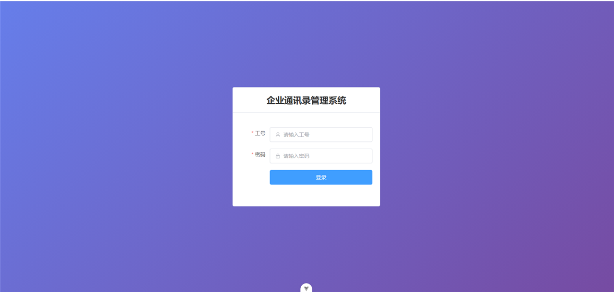
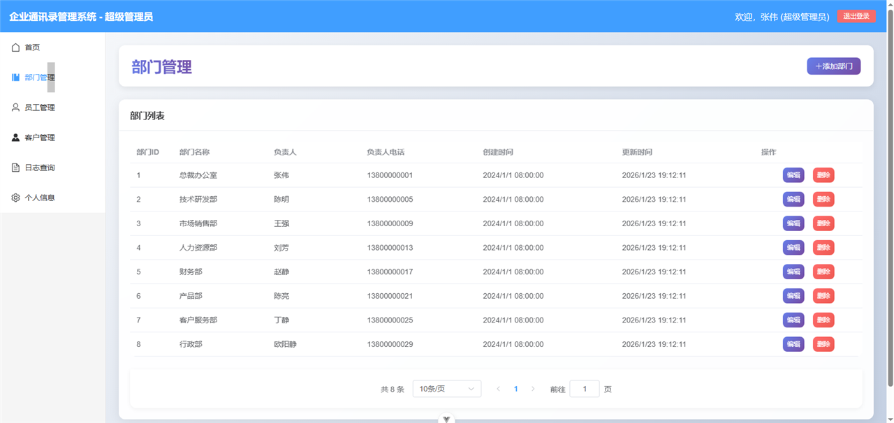
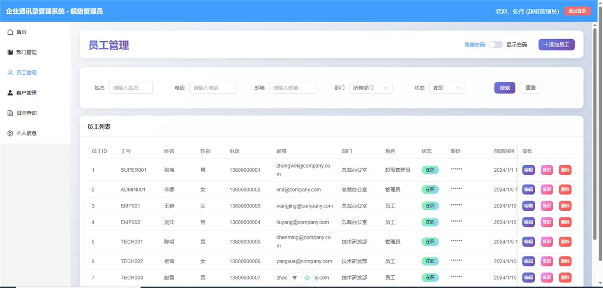

# 企业通讯录管理系统

一个基于 **Spring Boot 3 + Vue 3 + MySQL** 的前后端分离企业通讯录系统：支持部门组织架构、员工与客户信息维护、三级角色权限（超级管理员 / 管理员 / 员工）以及操作日志审计。

<p align="center">
  
  
</p>
<p align="center">
  
</p>

## 功能特性

| 模块 | 说明 |
|---|---|
| 登录认证 | 工号 + 密码登录，JWT 无状态认证，前端路由守卫按角色跳转 |
| 部门管理 | 部门新增 / 修改 / 删除，列表展示部门负责人与创建、更新时间 |
| 员工管理 | 工号、姓名、性别、电话、邮箱、部门、角色、在职状态等字段的增删改查，支持按姓名 / 电话 / 邮箱 / 部门 / 状态组合筛选 |
| 客户管理 | 外部联系人维护，按「个人 / 分组」隐私等级控制可见范围，离职与删除为软删除 |
| 操作日志 | 记录操作人、操作类型、目标表、目标 ID 以及变更前后数据快照（old_data / new_data） |
| 个人信息 | 查看与维护当前登录人的资料 |
| 在线接口文档 | 集成 Knife4j / OpenAPI 3，启动即可调试全部接口 |

## 角色权限

| 角色 | 权限范围 |
|---|---|
| 超级管理员 | 全公司部门、员工、客户与日志的查询和管理，可查看所有人的操作日志 |
| 管理员 | 查询全部部门与员工；本部门员工的离职 / 修改 / 新增；本部门客户的新增、修改、删除 |
| 员工 | 查询部门与员工信息；查看并维护本部门「分组级」客户，管理自己添加的客户 |

权限由 **前端路由 meta.roles + 后端 Spring Security** 双重校验。

## 技术栈

| 层 | 技术 |
|---|---|
| 后端 | Spring Boot 3.5、Spring Security 6 + JWT（jjwt 0.12）、MyBatis-Plus 3.5、Druid、MySQL 8、Knife4j 4.5 |
| 前端 | Vue 3（组合式 API）、TypeScript、Vite 7、Element Plus、Pinia、Vue Router 4 |
| 构建 | Maven（含 mvnw 包装器）、Node 20.19+ / 22.12+ |

## 项目结构

```
CorporateDirectory
├── backend/                        # Spring Boot 后端
│   ├── src/main/java/com/wei/
│   │   ├── config/                 # Security、JWT 过滤器与工具、MyBatis-Plus、Swagger
│   │   ├── controller/             # 登录、部门、员工、客户、操作日志接口
│   │   ├── service/                # 业务接口与实现
│   │   ├── mapper/                 # MyBatis-Plus Mapper
│   │   ├── entity/ dto/            # 数据库实体与传输对象
│   │   ├── response/               # 统一返回体 R / ResponseCode
│   │   ├── exception/              # 自定义异常与全局异常处理
│   │   └── tools/                  # 分页、搜索、登录校验等工具
│   └── src/main/resources/application.yml
├── frontend/                       # Vue 3 前端
│   └── src/
│       ├── api/                    # 接口封装（config.ts 中配置后端地址）
│       ├── views/boss|admin|employee/  # 三种角色的页面
│       ├── components/             # 布局、侧边栏、顶栏
│       ├── stores/                 # Pinia 用户状态
│       └── router/                 # 路由表与角色守卫
├── docs/images/                    # README 截图
├── init.sql                        # 建库建表 + 8 个部门 / 32 名员工演示数据
└── README.md
```

## 快速开始

### 环境要求

- JDK 17
- MySQL 8.0
- Node.js 20.19+ 或 22.12+
- Maven 3.6+（后端自带 `mvnw`，可不装）

### 1. 初始化数据库

```bash
mysql -u root -p < init.sql
```

脚本会创建数据库 `corporate_directory_wei`、4 张表（`department` / `employee` / `customer` / `oper_log`）并写入演示数据。

### 2. 启动后端

```bash
cd backend
./mvnw spring-boot:run          # Windows: mvnw.cmd spring-boot:run
```

- 端口：`8082`，上下文路径：`/wei`
- 接口文档：<http://localhost:8082/wei/doc.html>（或 `/wei/swagger-ui.html`）

数据库默认 `root / 123456`，可用环境变量覆盖：

```bash
DB_USERNAME=root
DB_PASSWORD=你的密码
JWT_SECRET=至少 64 字符的自定义密钥
```

### 3. 启动前端

```bash
cd frontend
npm install
npm run dev
```

打开 <http://localhost:5173>。前端请求地址在 `frontend/src/api/config.ts` 的 `BASE_URL`（默认 `http://localhost:8082/wei`）。

### 4. 登录

| 角色 | 工号 | 密码 |
|---|---|---|
| 超级管理员 | `SUPER001` | `123456` |
| 管理员 | `ADMIN001` | `123456` |
| 员工 | `EMP001` | `123456` |

登录后按角色自动进入 `/boss`、`/admin`、`/employee` 三套界面。

## 接口约定

所有接口返回统一结构：

```json
{
  "code": 200,
  "message": "操作成功",
  "data": {}
}
```

请求认证接口时在 Header 中携带 `Authorization: Bearer <token>`；`/login` 与接口文档相关路径已放行。

## 设计要点

- **统一响应**：`R<T>` 封装 code / message / data，异常由 `ControllerExceptionHandler` 统一转换为标准返回
- **认证与鉴权**：`JwtRequestFilter` 解析 Bearer Token，`SecurityConfig` 采用无状态会话，除登录与文档外均需认证
- **权限模型**：`employee.emp_role` 区分三种角色，前端路由守卫 + 后端鉴权双重校验
- **软删除**：员工状态用「在职 / 离职」、客户用 `is_deleted` 标记，保留历史数据
- **审计日志**：写操作记录操作人、目标表与变更前后快照，便于追溯

## 说明

- 本项目为课程设计 / 学习用途的演示项目：登录密码在数据库中为明文比对，CORS 白名单、JWT 密钥等均为开发环境默认值，**请勿直接用于生产环境**。
- 演示数据中的姓名、电话、邮箱均为虚构数据。
